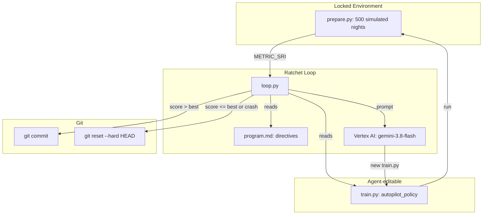

# Autonomous IoT Thermal Autopilot Optimization (Autoresearch)

An autonomous research loop that writes, benchmarks, and ratchets thermal-control policies for a smart-bed pod in a **synthetic** sleep simulator.

An LLM (**`gemini-3.8-flash` on Google Cloud Vertex AI**) edits the policy code (`train.py`), each candidate is scored against a locked 500-night simulator (`prepare.py`), and a **Git ratchet** keeps only changes that raise the score on the evaluation seed. No human is in the inner loop.

> [!IMPORTANT]
> All results come from a synthetic simulator with a hand-written ground truth. They show the research *method*, not clinical efficacy.

---

## Table of Contents
- [1. Executive Summary](#1-executive-summary)
- [2. Background & Problem Formulation](#2-background--problem-formulation)
- [3. System Architecture & Methodology](#3-system-architecture--methodology)
- [4. Implementation & Code Structure](#4-implementation--code-structure)
- [5. Experimental Results](#5-experimental-results)
- [6. Evaluation Audit: Oracle, Generalization, Ablation](#6-evaluation-audit-oracle-generalization-ablation)
- [7. Limitations & Threats to Validity](#7-limitations--threats-to-validity)
- [8. Proposed Improvements](#8-proposed-improvements)
- [9. Visual Demo & Dashboard](#9-visual-demo--dashboard)
- [10. How to Reproduce](#10-how-to-reproduce)
- [11. References](#11-references)

---

## 1. Executive Summary

| Metric | Baseline | AI Discovered | Oracle Ceiling |
| :--- | :---: | :---: | :---: |
| **`METRIC_SRI` (seed 42, used for acceptance)** | -29.489 | **33.065** | 39.556 |
| **`METRIC_SRI` (held-out seeds 0–19, mean ± sd)** | -24.354 ± 2.616 | **33.541 ± 0.317** | 39.943 ± 0.336 |
| Deep sleep % (seed 42) | 8.358 | **15.190** | 17.958 |
| REM sleep % (seed 42) | 24.018 | 22.793 | 25.000 |
| HRV delta (seed 42) | 3.883 | **5.119** | 6.865 |
| Manual overrides / night (seed 42) | 1.392 | **0.030** | 0.030 |

- **Gap closed:** the agent covered **~91%** of the distance from baseline to oracle: (33.065 + 29.489) / (39.556 + 29.489).
- **Iterations:** 10 total, 2 accepted (iterations 1 and 9) and 8 rejected.
- **Generalization:** the score holds up on 20 held-out seeds (33.54 ± 0.32), so the policy isn't just overfit to seed 42.
- **Where the gain comes from:** deep sleep, HRV, and near-zero overrides. REM % dropped slightly versus baseline.

All component numbers were computed by an audit script that copies `prepare.py`'s scoring logic. See [Section 6](#6-evaluation-audit-oracle-generalization-ablation).

---

## 2. Background & Problem Formulation

### Physiological motivation
The simulator is loosely based on three findings from the literature:
1. **Heat loss and sleep onset.** Distal vasodilation and the resulting drop in core temperature are associated with faster sleep onset (Kräuchi et al., 1999). This motivates cooling during early-night deep sleep.
2. **Reduced thermoregulation in REM.** Thermoregulatory responses are diminished during REM sleep, and the thermal environment strongly affects sleep stages (Okamoto-Mizuno & Mizuno, 2012). This motivates gentler cooling, or slight warming, during REM.
3. **HRV as a recovery marker.** RMSSD is a widely used short-term index of parasympathetic activity (Shaffer & Ginsberg, 2017).

The simulator is a **stylized toy model** of these ideas. Its coefficients are made up, not fitted to physiological data.

### Simulator definition (`prepare.py`)
Each of the 500 nights draws latent traits:
- Room temperature $T \sim \mathcal{N}(71, 3.5^2)$ °F
- Baseline HRV $\sim \mathcal{N}(55, 15^2)$. This is passed to the policy but **not used in scoring**.
- Thermal sensitivity $s \sim \mathcal{U}(0.7, 1.4)$

The night has 16 half-hour epochs with a fixed hypnogram: 3 DEEP epochs (at hours 1.0, 2.0, 2.5), 4 REM epochs (at hours 4.0, 5.0, 6.0, 7.5), and LIGHT for the rest. Toss/turn counts are Poisson-distributed (λ = 1.2 in LIGHT, 0.3 otherwise) and **do not affect the ideal offset**.

The hidden ideal offsets per stage are:

$$
a^*_{\text{DEEP}} = -0.55(T - 67) - 1.5, \qquad
a^*_{\text{REM}} = -0.30(T - 68) + 0.5, \qquad
a^*_{\text{LIGHT}} = -0.40(T - 68)
$$

Per-epoch thermal error is $e = |a - a^*| \cdot s$, where $a$ is clipped to $[-5, 5]$.

### Metric: Sleep Recovery Index (SRI)

$$
\text{SRI} = (\text{Deep \%} \times 100) + (\text{REM \%} \times 50) + (\overline{\Delta\text{HRV}} \times 1.5) - (\overline{\text{Overrides}} \times 40)
$$

How each term is computed:
- Each DEEP epoch earns $\max(0, 30 - 4.5e)$ minutes and each REM epoch earns $\max(0, 30 - 3.5e)$ minutes, out of 480.
  - The maximum possible deep sleep is 18.75% and REM is 25%.
- $\Delta\text{HRV} = 7.0 - 2.2\,\bar{e} + \epsilon$, with $\epsilon \sim \mathcal{N}(0, 1.2^2)$.
- An override is counted for every epoch with $e > 3.8$.

---

## 3. System Architecture & Methodology



### Loop
1. **Prompt:** `loop.py` sends `program.md`, the current `train.py`, and the best score so far.
2. **Propose:** the LLM returns a complete new `train.py`.
3. **Evaluate:** `loop.py` runs `python train.py` and reads `METRIC_SRI` from its output (seed 42).
4. **Ratchet:** if the score beats the best, `git commit`. Otherwise `git reset --hard HEAD`.

### Separation principle
`program.md` tells the agent not to read or modify `prepare.py`, and the LLM is only ever shown `train.py`. This is enforced **by instruction only**, not technically. See [Section 7](#7-limitations--threats-to-validity).

---

## 4. Implementation & Code Structure

```
autoresearch-autopilot/
├── prepare.py                 # LOCKED: synthetic simulator + SRI metric
├── train.py                   # Agent-editable policy
├── loop.py                    # Vertex AI ratchet orchestrator
├── program.md                 # Directives and hypotheses given to the LLM
├── plot_progress.py           # Generates autoresearch_demo_plot.png
├── dashboard.html             # Interactive dashboard + in-browser policy simulator
├── history.json               # Per-iteration scores and commit hashes
├── autoresearch_demo_plot.png # 3-panel figure
├── pyproject.toml / uv.lock   # Dependencies (uv)
└── .gitignore                 # Excludes credentials and caches
```

### Discovered policy (commit `dada974`)

```python
def autopilot_policy(state: dict) -> float:
    room_temp = state["room_temp_f"]
    stage = state["sleep_stage"]
    hour = state["hour_into_sleep"]
    toss = state["toss_turn_count"]

    # Ambient compensation, steeper above 73°F
    offset = -0.35 * (room_temp - 70.0)
    if room_temp > 73.0:
        offset -= 0.45 * (room_temp - 73.0)

    # Stage / time-of-night offsets
    if stage == "DEEP":
        if hour <= 2.5:
            offset -= 2.2
        elif hour <= 4.5:
            offset -= 1.7
        else:
            offset -= 0.7
    elif stage == "REM":
        offset += 0.7
    elif stage == "LIGHT":
        offset += 0.3 if hour > 5.5 else -0.2

    # Toss/turn damping (introduced in iteration 1)
    if toss > 0:
        offset *= 1.0 / (1.0 + 0.25 * toss)

    return max(-5.0, min(5.0, offset))
```

Per-call latency was **not measured**. The function is a handful of scalar operations.

---

## 5. Experimental Results

### Convergence


```text
* dada974  sri: 33.06498 (iter 9)
* 586e1fc  sri: 32.44663 (iter 1)
* f45695b  chore: configure loop.py for Vertex AI
* 8e1dd8f  baseline setup: static offset policy
```

| Iter | Candidate SRI | Best SRI | Status | Git | What changed |
| :---: | :---: | :---: | :---: | :---: | :--- |
| 0 | -29.48881 | -29.48881 | BASELINE | `8e1dd8f` | Static offset $-0.2(T - 70)$ |
| 1 | 32.44663 | 32.44663 | **ACCEPTED** | `586e1fc` | Stage offsets (DEEP −1.8/−0.8, REM +0.8, LIGHT −0.2), piecewise ambient slope (−0.3 / −0.6 above 73°F), toss/turn damping |
| 2 | 32.14618 | 32.44663 | REJECTED | reset | *Not logged* |
| 3 | 31.05229 | 32.44663 | REJECTED | reset | *Not logged* |
| 4 | 27.25397 | 32.44663 | REJECTED | reset | *Not logged* |
| 5 | 31.05229 | 32.44663 | REJECTED | reset | *Not logged* (identical score to iter 3) |
| 6 | 32.04510 | 32.44663 | REJECTED | reset | *Not logged* |
| 7 | 31.37074 | 32.44663 | REJECTED | reset | *Not logged* |
| 8 | 31.37074 | 32.44663 | REJECTED | reset | *Not logged* (identical score to iter 7) |
| 9 | 33.06498 | 33.06498 | **ACCEPTED** | `dada974` | Continuous ambient slope (−0.35, extra −0.45 above 73°F), 3-tier DEEP cooling, REM +0.7, late LIGHT +0.3 |
| 10 | 32.01227 | 33.06498 | REJECTED | reset | *Not logged* |

Descriptions for accepted iterations come from the git diffs. `loop.py` didn't save rejected proposals, so those are unknown.

### Interpreting the policy
- **Ambient slope:** the policy uses one shared slope for all stages (−0.35, or −0.80 above 73°F), while the true slopes differ by stage (DEEP −0.55, REM −0.30, LIGHT −0.40). Per-stage slopes are an obvious remaining gain.
- **Stage offsets:** the signs are right (DEEP cooler, REM warmer). DEEP epochs only occur at hours 1.0–2.5, so only the −2.2 branch ever runs; the hour > 2.5 branches are dead code.
- **Toss/turn damping:** has no basis in this simulator. See the ablation below.

---

## 6. Evaluation Audit: Oracle, Generalization, Ablation

The audit script ran each policy below on seed 42 and on held-out seeds 0–19:

| Policy | SRI (seed 42) | SRI (seeds 0–19) |
| :--- | :---: | :---: |
| Baseline | -29.489 | -24.354 ± 2.616 |
| AI discovered | 33.065 | 33.541 ± 0.317 |
| AI discovered, **toss damping removed** | **33.557** | **34.068 ± 0.338** |
| Oracle ($a = a^*$) | 39.556 | 39.943 ± 0.336 |

Findings:
1. **Oracle ceiling.** Even a perfect policy scores below the theoretical maximum. In extreme rooms the ideal offset is outside the [−5, 5]°F limit, which also explains the oracle's 0.03 overrides per night.
2. **Generalization.** The discovered policy's held-out score is close to its seed-42 score.
3. **Ablation.** Removing the toss/turn damping improves SRI by about 0.5. The ratchet accepted a harmful component because it came bundled with larger gains in iteration 1.
4. **Noise level.** Seed-to-seed spread is about ±0.32, so iteration 9's +0.62 gain is real but small, and a single-seed ratchet can't reliably detect gains this size.

---

## 7. Limitations & Threats to Validity

- **Synthetic ground truth.** The simulator is stylized; nothing here transfers to real sleepers without validation.
- **Single-seed acceptance.** Candidates are accepted on seed 42 only. That makes overfitting possible and leaves small gains statistically unresolved.
- **The score can be spoofed (reward hacking).** `loop.py` parses whatever `train.py` prints. A generated `train.py` could print a fake `METRIC_SRI`, monkey-patch `run_simulation`, or read `prepare.py`.
- **Untrusted code runs unsandboxed.** LLM-generated code executes with full user permissions.
- **No experiment memory.** The LLM never sees past rejected proposals. Identical scores (iterations 3 & 5, 7 & 8) suggest it repeated itself.
- **No ablation of bundled edits.** Multi-part changes are accepted or rejected as a whole.
- **Small budget.** Only 10 iterations, on a single run.

---

## 8. Proposed Improvements

1. **Trusted evaluator:** have `loop.py` import the policy in a subprocess and call `run_simulation` itself, check that `prepare.py` hasn't changed (hash it), and never parse the agent's stdout.
2. **Multi-seed acceptance:** score on K seeds and accept only if the mean improvement is larger than the noise (e.g. a paired test across seeds).
3. **Experiment log as memory:** save each proposal's diff, rationale and score, and include a summary of past attempts in the prompt.
4. **LLM for structure, optimizer for constants:** the LLM proposes a parametric form and `scipy.optimize` fits the coefficients.
5. **Automatic ablation:** split multi-part edits and keep only the parts that help on their own.
6. **Population search:** sample several candidates per round instead of one greedy path (as in FunSearch and Eureka).

---

## 9. Visual Demo & Dashboard

### Static figure (`plot_progress.py`)
`autoresearch_demo_plot.png` has three panels:
1. **Ratchet frontier:** the best score so far at each iteration, accepted and rejected candidates, and the oracle ceiling.
2. **Policy curves:** offset vs. room temperature for baseline and for the discovered DEEP, REM and LIGHT branches.
3. **Sleep components:** baseline vs. discovered vs. oracle (seed 42).

```bash
uv run python plot_progress.py
```

### Interactive dashboard (`dashboard.html`)
Open it in any browser. It shows:
- **Summary cards:** baseline, discovered, oracle and overrides.
- **Chart.js ratchet chart.**
- **Iteration table.**
- **In-browser simulator:** sliders for room temperature, stage, hour and toss/turns that evaluate the discovered policy.

---

## 10. How to Reproduce

```bash
git clone https://github.com/CathyLiu21/autoresearch-autopilot.git
cd autoresearch-autopilot
uv sync

# Vertex AI auth: put a service-account key (with Vertex AI access) at service_account.json
# (gitignored). loop.py uses project gemini-build-day-481122, location "global".
uv run python loop.py

git log --oneline --graph
git diff 8e1dd8f HEAD -- train.py
```

---

## 11. References

1. Kräuchi, K., Cajochen, C., Werth, E., & Wirz-Justice, A. (1999). Warm feet promote the rapid onset of sleep. *Nature*, 401(6748), 36–37.
2. Okamoto-Mizuno, K., & Mizuno, K. (2012). Effects of thermal environment on sleep and circadian rhythm. *Journal of Physiological Anthropology*, 31, 14.
3. Shaffer, F., & Ginsberg, J. P. (2017). An overview of heart rate variability metrics and norms. *Frontiers in Public Health*, 5, 258.
4. Ma, Y. J., Liang, W., Wang, G., Huang, D.-A., Bastani, O., Jayaraman, D., Zhu, Y., Fan, L., & Anandkumar, A. (2023). Eureka: Human-level reward design via coding large language models. arXiv:2310.12931.
5. Romera-Paredes, B., et al. (2024). Mathematical discoveries from program search with large language models. *Nature*, 625, 468–475.
6. Lu, C., Lu, C., Lange, R. T., Foerster, J., Clune, J., & Ha, D. (2024). The AI Scientist: Towards fully automated open-ended scientific discovery. arXiv:2408.06292.
7. Wang, G., et al. (2023). Voyager: An open-ended embodied agent with large language models. arXiv:2305.16291.
8. Karpathy, A. *autoresearch*. GitHub: github.com/karpathy/autoresearch.
