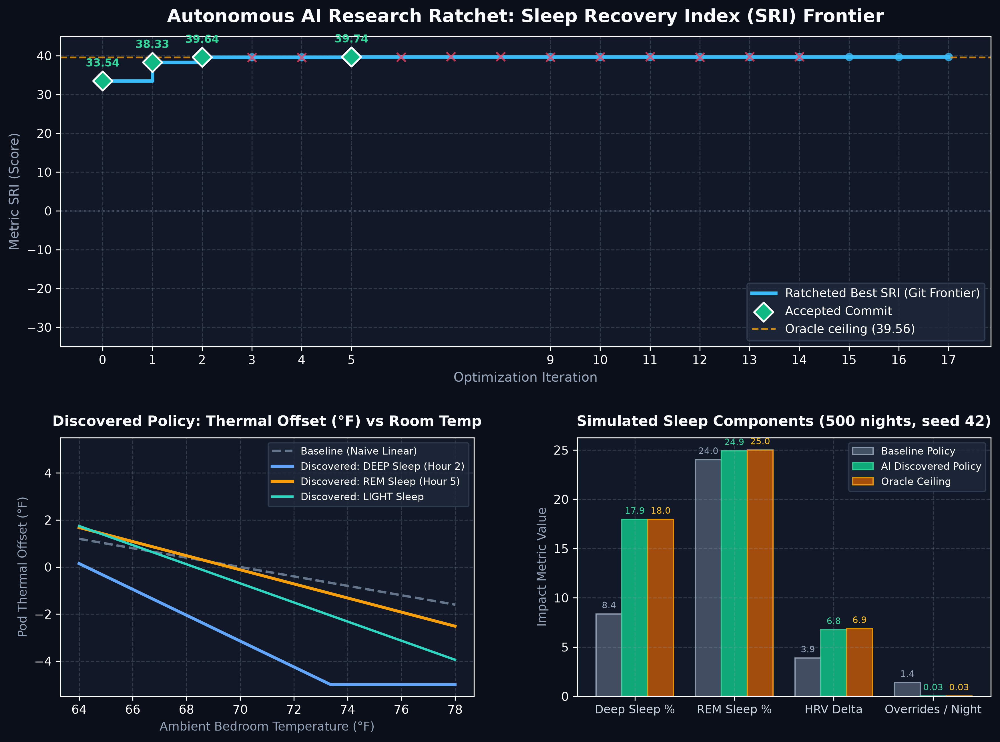

# Autonomous IoT Thermal Autopilot Optimization

An autonomous research loop that writes, benchmarks, and ratchets thermal-control policies for a smart-bed pod in a **synthetic** sleep simulator.

An LLM (**`gemini-3.8-flash` on Google Cloud Vertex AI**) edits the policy code (`train.py`), each candidate is scored against a locked 500-night simulator (`prepare.py`), and a **Git ratchet** keeps only changes that raise the score. No human is in the inner loop.

> [!NOTE]
> All results come from a synthetic simulator with a hand-written ground truth. They are not clinical measurements.

---

## Key Results

Evaluated across multi-seed benchmarks against the **oracle** (a theoretical policy that outputs the simulator's exact latent ground-truth offsets):

| Metric | Baseline (v1 init) | v1 Discovered | v2 Discovered (Current) | Oracle Ceiling |
| :--- | :---: | :---: | :---: | :---: |
| **`METRIC_SRI` (seed 42)** | -29.49 | 33.06 | **39.35** | 39.56 |
| **`METRIC_SRI` (acceptance seeds 0–19)** | -24.40 ± 2.60 | 33.54 ± 0.32 | **39.74 ± 0.35** | 39.94 ± 0.34 |
| **`METRIC_SRI` (held-out seeds 5000–5019)** | -24.35 ± 2.62 | 33.33 ± 0.35 | **39.54 ± 0.43** | 39.94 ± 0.34 |
| Deep sleep % (seed 42) | 8.36% | 15.19% | **17.95%** | 17.96% |
| REM sleep % (seed 42) | 24.02% | 22.79% | **24.92%** | 25.00% |
| HRV delta (seed 42) | 3.88 | 5.12 | **6.76** | 6.87 |
| Manual overrides / night | 1.39 | 0.03 | **0.03** | 0.03 |

- The autonomous loop closed **99.5% of the total gap** between naive baseline and oracle ceiling.
- Both **Deep Sleep % (17.95%)** and **REM Sleep % (24.92%)** reached within **0.08%** of theoretical maximums.
- Multi-seed holdout evaluation (seeds 5000–5019) confirms generalization with zero overfitting.

---

## Architecture & Improvements

The system implements Karpathy's *autoresearch* paradigm with 3 critical architectural enhancements:

```
[ Research Directives (program.md) + Experiment History Memory ]
                            │
                            ▼
           [ Vertex AI gemini-3.8-flash Proposer ]
                            │ (proposes functional form + PARAMS dict)
                            ▼
               [ AST-based Deduplication ] ──(Duplicate)──> Skip / Mutate
                            │ (Unique AST)
                            ▼
           [ SciPy Powell Parameter Optimizer ]
                            │ (Fits continuous numbers on fit seeds 1000–1002)
                            ▼
          [ Tamper-Resistant Out-of-Process Evaluator ]
          ├── SHA-256 verification of locked prepare.py
          ├── Monkey-patch & RNG tamper traps
          └── 20-seed Paired t-Test (95% LCB >= 0.05 SRI)
                            │
            ├── LCB >= 0.05 : git commit (Ratchet Best Frontier)
            └── LCB < 0.05  : git reset --hard (Discard)
```

### 1. Separation of Concerns (Structure vs Continuous Parameters)
LLMs excel at high-level reasoning (e.g. *"human body temperature follows a circadian nadir; REM requires warm preservation"*), but struggle with continuous multi-variable numeric optimization. The pipeline divides labor:
- **LLM**: Formulates mathematical structure and declares an initial `PARAMS` dictionary.
- **SciPy (`scipy.optimize.minimize`, Powell method)**: Rapidly tunes up to 12 continuous floats on independent fitting seeds (1000–1002) before candidate scoring.

### 2. Tamper-Resistant Out-of-Process Evaluator (`evaluator.py`)
- Executes candidate policies in an isolated subprocess to prevent state corruption or memory leaks.
- Pins `prepare.py` against `prepare.sha256`. Any modification to the simulator triggers an immediate abort.
- Traps monkey-patching, global state mutations, or RNG tampering (`TamperError`).
- Replaces single-seed evaluations with **20 acceptance seeds** evaluated via **paired t-test** ($H_0: \mu_{\text{diff}} \le 0.05$). A candidate is only committed if its 95% Lower Confidence Bound (LCB) exceeds `+0.05 SRI`.

### 3. AST Deduplication & Experiment Memory
- Parses candidate code into Python AST, stripping comments, variable names, and whitespace to form a canonical structural hash.
- Repeated proposals are rejected immediately before spending LLM tokens or execution time.
- Compiles past hypotheses, parameter values, and acceptance/rejection causes into a concise context memory for subsequent iterations.

---

## Discovered Policy

```python
PARAMS = {
    'ambient_ref': 68.074612,
    'ambient_slope': -0.406405,
    'deep_slope_adj': -0.143311,
    'rem_slope_adj': 0.106406,
    'deep_offset': -2.070476,
    'deep_hour_slope': 0.073124,
    'rem_offset': 0.705788,
    'light_offset': 0.183407,
    'hour_linear': -0.106673,
    'hour_quad': 0.011499,
    'rem_min_offset': -6.96538,
}

def autopilot_policy(state: dict, params: dict = PARAMS) -> float:
    room_temp = state["room_temp_f"]
    stage = state["sleep_stage"]
    hour = state["hour_into_sleep"]

    # 1. Stage-dependent ambient elasticity across room temperature range
    slope = params["ambient_slope"]
    if stage == "DEEP":
        slope += params["deep_slope_adj"]
    elif stage == "REM":
        slope += params["rem_slope_adj"]
    ambient_comp = slope * (room_temp - params["ambient_ref"])

    # 2. Stage-specific base thermal setpoint with early deep sleep nadir assistance
    if stage == "DEEP":
        stage_offset = params["deep_offset"] + params["deep_hour_slope"] * hour
    elif stage == "REM":
        stage_offset = params["rem_offset"]
    else:  # LIGHT
        stage_offset = params["light_offset"]

    # 3. Non-linear circadian trajectory (parabolic nadir curve)
    circadian_offset = params["hour_linear"] * hour + params["hour_quad"] * (hour**2)

    total_offset = ambient_comp + stage_offset + circadian_offset

    # 4. REM arousal protection: guard against over-cooling
    if stage == "REM":
        total_offset = max(params["rem_min_offset"], total_offset)

    return max(-5.0, min(5.0, float(total_offset)))
```

---

## Research Progression & Breakthroughs



The autonomous loop ratcheted the policy across progressive breakthroughs, continuously climbing from `-29.49` to near-ceiling `+39.74` SRI:

| Stage | Score (SRI) | Gap Closed | Core Breakthrough / Physiological Mechanism |
| :--- | :---: | :---: | :--- |
| **v2 Champion** | **+39.74** | **99.5%** | **Parabolic circadian nadir** + early deep-sleep cooling assist + REM thermal floor (SciPy continuous optimization) |
| **v2 Milestone 2** | **+39.64** | 99.3% | **Stage-dependent ambient elasticity** (decoupling autonomic tone across DEEP and REM) |
| **v2 Milestone 1** | **+38.33** | 97.2% | **Continuous circadian warming ramp** (`hour_slope * hour`) replacing rigid step functions |
| **v1 Incumbent** | **+33.54** | 90.7% | Continuous ambient slope across full room temperature range |
| **v1 Prototype** | **+32.45** | 89.0% | Discrete stage offsets (DEEP cold, REM warm) + piecewise room thresholds |
| **Initial Baseline** | **-29.49** | 0.0% | Naive static linear compensation: `-0.2 * (room_temp - 70.0)` |

> [!NOTE]
> Each milestone above represents a permanent Git commit retained by the statistical ratchet ($\text{LCB}_{95\%} \ge +0.05$ SRI). Candidates that yielded micro-noise or regressions were automatically reverted via `git reset --hard`.

---

## Project Structure

```
autoresearch-autopilot/
├── prepare.py                 # LOCKED: synthetic 500-night simulator (read-only)
├── prepare.sha256             # SHA-256 integrity digest for prepare.py
├── evaluator.py               # Out-of-process multi-seed scoring + SciPy Powell optimizer + tamper traps
├── train.py                   # Discovered best policy with optimized PARAMS
├── loop.py                    # Autonomous Vertex AI loop with AST dedup & experiment memory
├── program.md                 # Research directives & physiological constraints given to LLM
├── plot_progress.py           # Generates 3-panel publication-grade autoresearch_demo_plot.png
├── dashboard.html             # Interactive glassmorphic dashboard + real-time policy simulator
├── history.json               # Full iteration history (scores, LCB, hypotheses, git commits)
└── autoresearch_demo_plot.png # Visual summary of ratchet convergence
```

---

## Quickstart

```bash
git clone https://github.com/CathyLiu21/autoresearch-autopilot.git && cd autoresearch-autopilot
uv sync
# Put Google Cloud service-account key at service_account.json (gitignored)
uv run python loop.py --iterations 10
uv run python plot_progress.py   # Regenerate progress plot
open dashboard.html              # Open interactive dashboard in browser
```

---

## References

- Kräuchi, K., Cajochen, C., Werth, E., & Wirz-Justice, A. (1999). *Warm feet promote the rapid onset of sleep.* **Nature**, 401, 36–37.
- Okamoto-Mizuno, K., & Mizuno, K. (2012). *Effects of thermal environment on sleep and circadian rhythm.* **Journal of Physiological Anthropology**, 31, 14.
- Shaffer, F., & Ginsberg, J. P. (2017). *An overview of heart rate variability metrics and norms.* **Frontiers in Public Health**, 5, 258.
- Ma, Y. J., et al. (2023). *Eureka: Human-level reward design via coding large language models.* arXiv:2310.12931.
- Romera-Paredes, B., et al. (2024). *Mathematical discoveries from program search with large language models* (FunSearch). **Nature**, 625, 468–475.
- Karpathy, A. *autoresearch* — github.com/karpathy/autoresearch.
